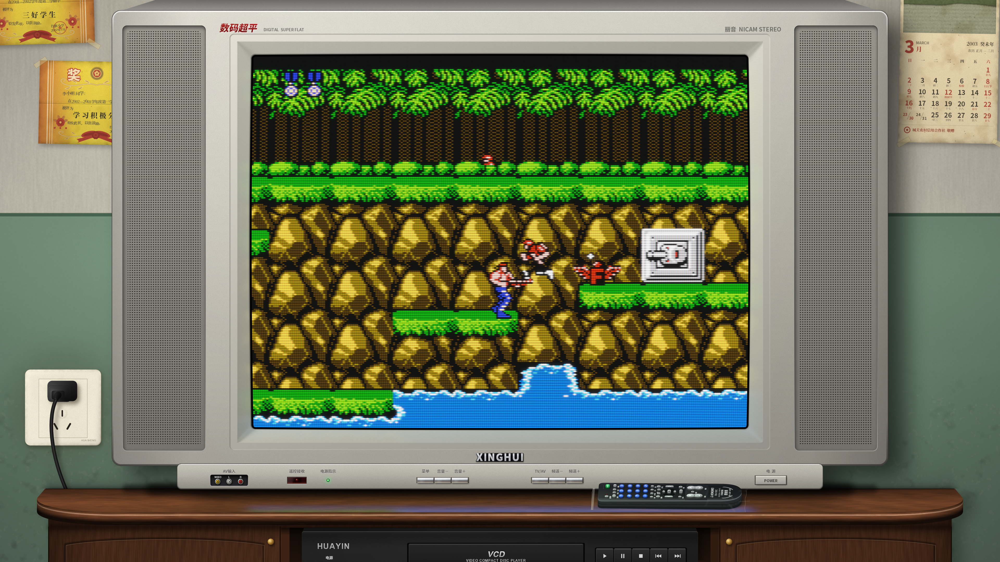
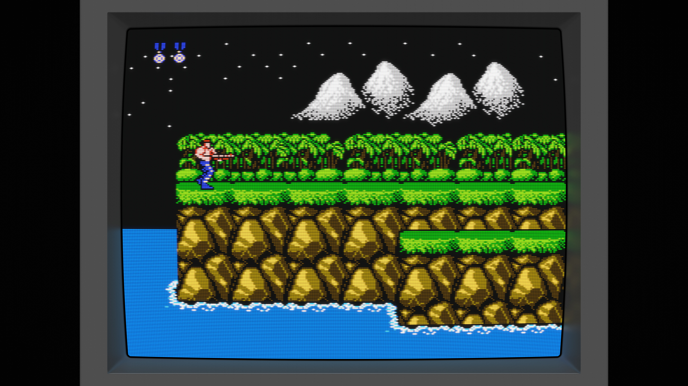
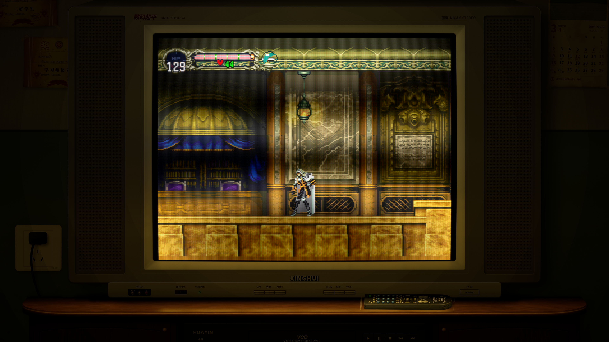
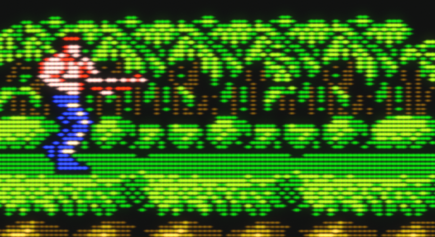
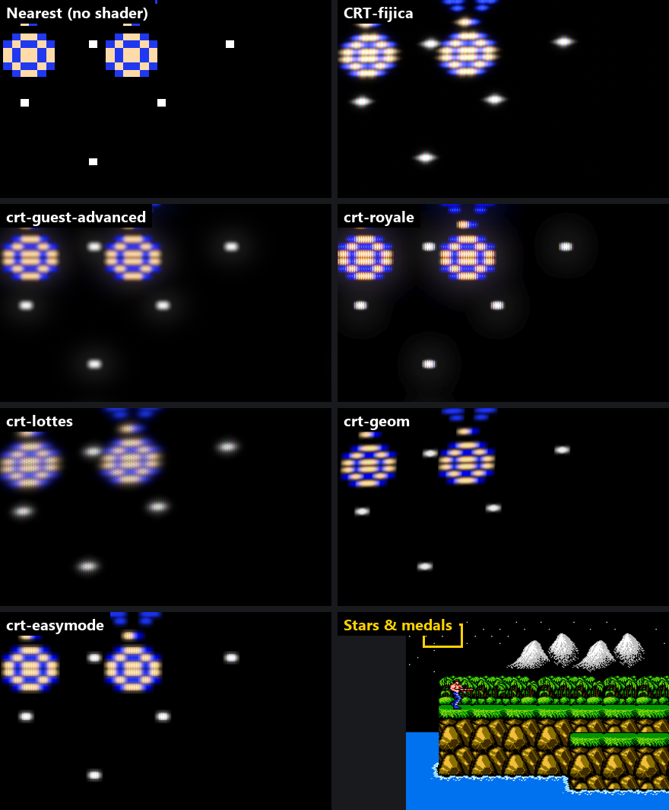
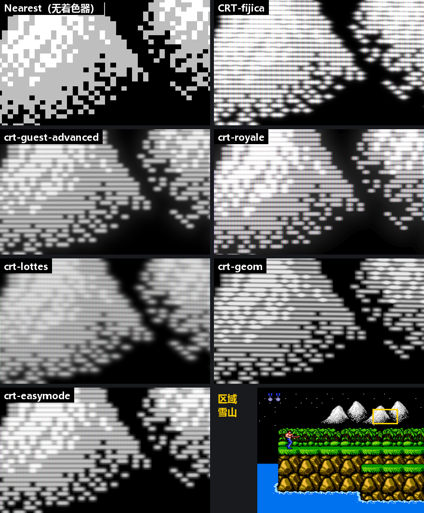
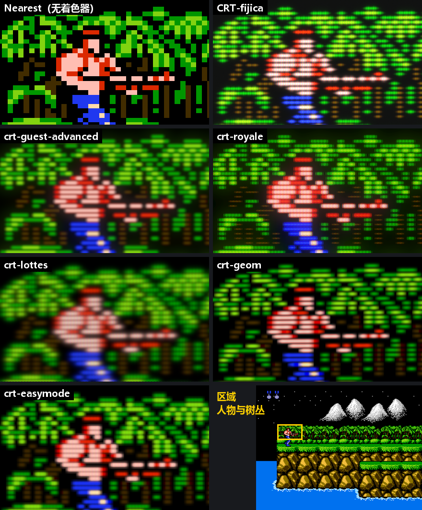
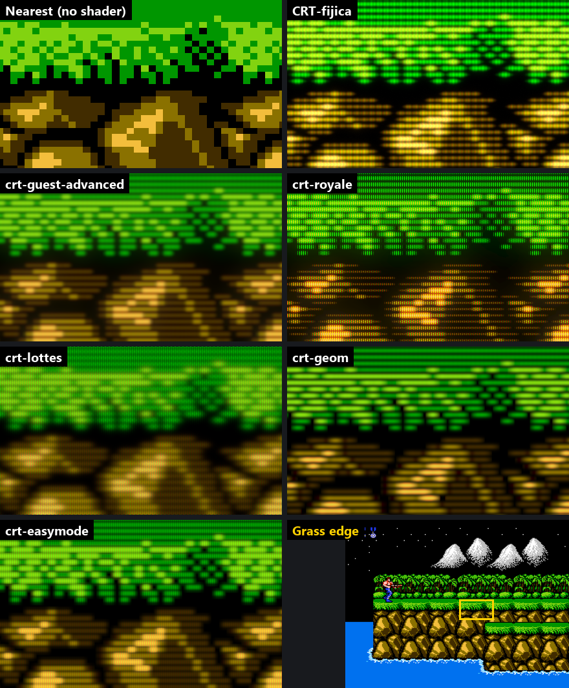
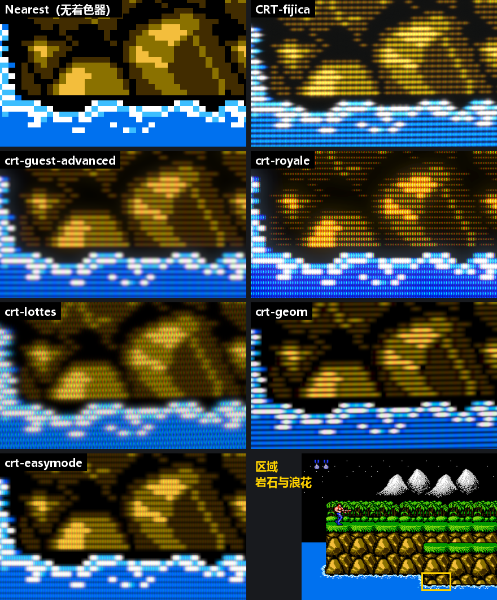
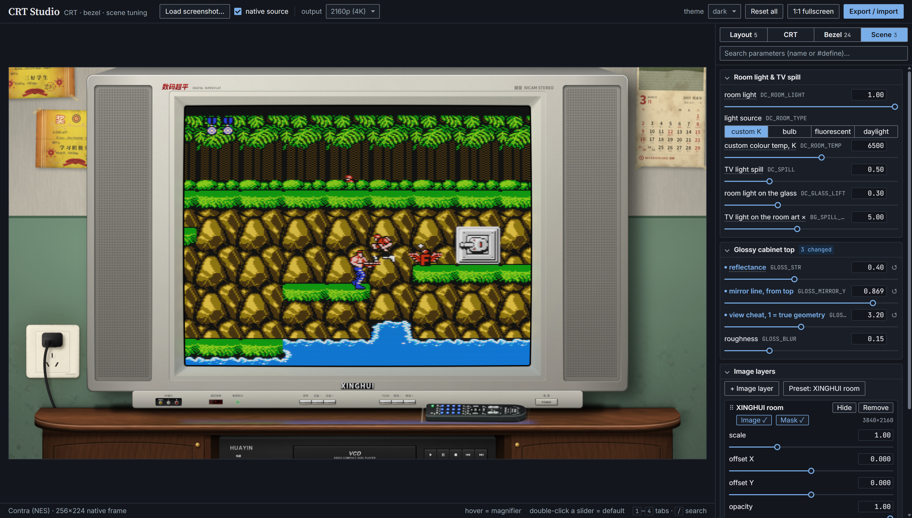

# CRT-fijica

**English** · [简体中文](README.zh-CN.md)

**A physically inspired CRT shader for RetroArch, with a bezel and scene that can be swapped independently.**



CRT-fijica (from the Japanese フィジカル, *physical*) does not stack effects one on top of another. It follows the
tube's physical process step by step: electron gun → beam → phosphor → persistence → glass scattering. Scanline
thickness, bloom in bright areas, edge falloff and the halo in the glass all come out of that chain.

Everything outside the screen is a separate layer that meets the CRT through a single shared screen layout:
- a sloped bezel and a flat frame;
- the picture's reflection on the bezel;
- a background scene;
- room lighting and the TV's light spilling onto its surroundings.

Either side can be replaced on its own; curvature and position always stay in sync.

## Features

- **Physical CRT**:
  - space-charge broadening of the beam makes bright areas fatter;
  - energy-conserving scanline convolution keeps scanlines even in flat colour areas;
  - three phosphor masks (aperture grille / slot / dot);
  - per-channel phosphor persistence;
  - halation in the glass;
  - progressive and interlaced scan.
- **Spherical faceplate**: the raster is laid onto a curved glass by deflection angle; horizontal and vertical
  curvature can be set separately.
- **Geometrically modelled bezel**: lip, slopes, outer edge and frame are surfaces with normals, all lit by one light
  (diffuse + plastic sheen). Bright and dark edges follow the light direction instead of being painted on.
- **Scene lighting**:
  - room light from daylight down to lights-off on a continuous slider;
  - bulb, fluorescent, daylight or a custom colour temperature;
  - the picture lights up the bezel, the cabinet and the wall around it;
  - glossy surfaces reflect the picture.
- **CRT Studio**: a browser tool that mirrors the shader line for line, for live tuning and one-click export.

## Screenshots

| Physics preset: procedural bezel | Living room, lights off |
|---|---|
|  |  |

1:1 detail: scanlines grow thicker with brightness; the phosphor grille and the bloom are clearly visible.



All screenshots are 3840×2160 originals. Scanlines and the mask are periodic patterns only a few pixels wide, so they
show moiré when scaled down; open the image at 100% to judge them.

## Comparison with other shaders

The same native *Contra* frame (256×224) through several classic CRT shaders that ship with RetroArch, and through
this project. Everything was actually run in RetroArch:
- Vulkan driver, 4:3 fullscreen output at 2880×2160, GPU screenshots;
- every other shader with its default preset;
- this project with a CRT-only comparison preset: the same physics chain as `crt-decoupled-physics`, but without the
  bezel, frame and reflection, so the area outside the screen is pure black like the others; the screen fills the
  output and the room light is off (`DC_ROOM_LIGHT` 0).

Each image below is a 1:1 crop with no scaling; the last tile shows where the region sits in the frame.

**Stars & medals**: single-pixel stars and small bright sprites. Look at the glow around the bright dots: how far it
reaches and whether it fades out naturally.



This project's glow fades smoothly all the way out: the whole chain runs in float framebuffers and the output is
dithered, so the dark end shows no banding. crt-royale computes its glow at low resolution in 8-bit framebuffers;
only a few grey levels are left in the dark end, which leaves a hard-edged dark ring around each star.

**Snowy peaks**: large bright areas and dithered white pixels



**Soldier & trees**: fine green detail and skin tones



**Grass edge**: the transition from bright green to black



**Rocks & surf**: shadow detail and white highlights



In normal use the room light is on by default (`DC_ROOM_LIGHT` 1): the glass reflects a little room light, so blacks
are slightly lifted.

## Performance

Same input, RetroArch running uncapped (no vsync, no audio sync), compared by time per frame. The shaders are
compared at the same 4:3 output (2880×2160); this project's full presets are listed at the 16:9 fullscreen
(3840×2160) they are meant for.
The time is taken from the difference between two runs of different length, which cancels start-up and shader
compilation. Test system: RTX 4070 SUPER, Vulkan.

| Shader | Time per frame | Frame rate |
|---|---|---|
| Nearest (no shader: RetroArch's own overhead) | 0.26 ms | ~3800 fps |
| crt-easymode | 0.42 ms | ~2400 fps |
| crt-geom | 0.76 ms | ~1300 fps |
| crt-guest-advanced | 0.94 ms | ~1060 fps |
| crt-royale | 0.95 ms | ~1050 fps |
| **CRT-fijica**, CRT only (as in the comparison above) | 0.99 ms | ~1010 fps |
| crt-lottes | 1.18 ms | ~850 fps |
| **CRT-fijica** `crt-decoupled-physics` (+ bezel and reflection), 16:9 3840×2160 | 1.72 ms | ~580 fps |
| **CRT-fijica** `crt-decoupled-xinghui` (+ living-room scene), 16:9 3840×2160 | 1.73 ms | ~580 fps |

The CRT alone costs about the same as guest-advanced and royale. Even the full living-room scene at 4K uses about 10%
of a 16.7 ms frame at 60 Hz. Individual measurements vary by about 5–8%.

## Installation

1. Use a video driver that supports slang shaders: Vulkan (recommended), D3D11/12 or glcore.
2. Put this repository into RetroArch's `shaders` folder, or link it there. On Windows:

   ```bat
   mklink /J "<RetroArch>\shaders\CRT-fijica" "<repository folder>"
   ```

3. In RetroArch, go to **Shaders → Load Preset** and pick a preset.

## Presets

| Preset | Contents |
|---|---|
| `crt-decoupled-physics.slangp` | Physical CRT + dark grey procedural bezel, no background |
| `crt-decoupled-xinghui.slangp` | A 2000s Chinese living room: silver TV, cabinet, VCD player, remote |

## Tuning

### Runtime parameters

Adjustable in RetroArch's shader parameter menu.

**CRT**

| Parameter | What it does |
|---|---|
| `gamma_gun` | Electron-gun gamma (overall contrast) |
| `sigma0` / `sigma_h` | Vertical / horizontal beam width (scanline thickness / horizontal softness) |
| `k_sc` / `alpha_sc` | How much bright areas fatten / the shape of that curve |
| `scan_gamma` | Scanline contrast: deepens the gaps between dark scanlines. An aesthetic control, not part of the physical chain; gaps that bright lines fill through space charge are left alone |
| `mask_type` / `mask_pitch` / `mask_strength` | Mask type / pitch (output pixels) / strength |
| `e_sat` / `brightness` | Phosphor saturation knee / brightness |
| `persist_r/g/b` | Per-channel persistence: the share of a frame's light still glowing one 60 Hz frame later (rescaled to the real refresh rate); the trail adds to the new picture |
| `halo_weight` / `halo_spread` | Glass halation strength / radius |
| `vignette` / `d_gun` / `k_edge` | Edge falloff / deflection distance / spot elongation at the edges |
| `scan_mode` / `interlace_off` | Progressive, interlaced or auto / brightness of the other field when interlaced (perceptual, sets the amount of flicker) |

**Layout (`Layout:`)**

| Parameter | What it does |
|---|---|
| `DC_SCALE` / `DC_POS_X` / `DC_POS_Y` | Screen size / centre position |
| `DC_ASPECT` | Picture aspect ratio |
| `DC_CURVE_X` / `DC_CURVE_Y` | Faceplate curvature across the width / height (bows the top and bottom / left and right edges) |
| `DC_CORNER` | Screen corner radius |
| `DC_BG_ON` / `DC_FG_ON` | Background / foreground image on or off |

**Lighting (`Light:`)**

| Parameter | What it does |
|---|---|
| `DC_ROOM_LIGHT` | Room light: 0 lights off, 0.5 a lamp, 1 daylight |
| `DC_ROOM_TYPE` / `DC_ROOM_TEMP` | Light source (custom colour temperature, bulb, fluorescent, daylight) / custom colour temperature |
| `DC_SPILL` | How strongly the picture lights its surroundings |
| `DC_GLASS_LIFT` | Room light reflected by the screen glass |

### Bezel look

The bezel's shape, material and lighting are compile-time parameters, with defaults in `decoupled/dc-composite.inc`.
For a new look, write a small wrapper that overrides what you want to change and includes it:

```glsl
#version 450
#define BZL_COLOR_VAL   0.73     // silver plastic
#define LIGHT_ANGLE     135.0    // light from the upper left
#define GLOSS_STR       0.40     // reflection on the cabinet top
#include "dc-composite.inc"
```

| Group | Parameters |
|---|---|
| Size | `BZL_WIDTH(_X)`, `FRM_WIDTH(_X)`, `BZL_OUTER_CORNER`, `FRM_OUTER_CORNER` |
| Material | `BZL_COLOR_HUE/SAT/VAL`, `BZL_NOISE`, `BZL_GLOSS`, `BZL_SHINE`, `FRM_COLOR_*` |
| Light | `LIGHT_ANGLE`, `LIGHT_ELEV`, `AMBIENT`, `BZL_SLOPE`, `LIGHT_GRAD_X/Y` |
| Rounded edges | `LIP_WIDTH`, `LIP_ROLL`, `BZL_EDGE_W`, `FRM_EDGE_W`, `FRM_EDGE_ROLL` |
| Miter seams | `CORNER_FADE`, `CREASE_W_IN/OUT`, `CREASE_STR` |
| Screen reflection | `REFL_STR`, `REFL_FALLOFF`, `REFL_BLUR`, `REFL_CORNER` |
| Glossy surfaces | `GLOSS_STR`, `GLOSS_MIRROR_Y`, `GLOSS_STRETCH`, `GLOSS_BLUR` |

Lengths are in tube heights, angles in degrees. Each parameter is described in the comments of `dc-composite.inc`.
The easiest way is to tune in CRT Studio and export.

## How it works

```
game frame
 │ 01 linearize      signal decode, gun response → linear beam current
 │ 02 beam-v         vertical beam convolution (energy-conserving), progressive / interlaced scan
 │ 03 beam-h         horizontal beam convolution
 │ 04 phosphor       phosphor mask, saturation and persistence
 │ 05–07 halo        glass halation (1/4 resolution, separable Gaussian)
 ▼
 │ dc-crt-physics    curve and place the picture by the screen layout
 │ dc-composite      bezel, screen reflection, background, scene lighting
 │ dc-foreground     (optional) a layer in front of the glass
 ▼
output
```

**Shared screen layout.** The CRT, the bezel and the reflection share only one set of parameters: the screen's
position, size, aspect ratio, curvature and corner radius, defined in `decoupled/dc-screen-layout.inc`. All three
read the same values, so they always line up, and any of them can be replaced without touching the others.

**Faceplate.** The faceplate is treated as a patch of a sphere that the beam sweeps evenly in deflection angle. Seen
from the front, the centre is slightly magnified, the edge midpoints stay fixed and the corners pull in. The mapping
has a closed form in both directions.

**Bezel.** Seen from the tube outward, the bezel is a cross-section profile:
1. the black gap;
2. a lip rolling down into the tube;
3. four sloped faces meeting at straight miters;
4. a rounded outer edge;
5. the flat frame;
6. the frame's outer edge.

Each part's normal comes from its geometry, and one light gives diffuse shading and sheen. The miter seams are lit by
the normal halfway between the two faces they join.

**Scene lighting.** Everything drawn is multiplied in linear light by the room light, plus the TV's spill:
- bezel, frame and background art are all lit;
- the spill colour comes from blurred mips of the picture, so the presets enable `mipmap_input`;
- the background's `SpillMask` texture says how much spill each pixel receives (R) and where the glossy, picture-
  reflecting surfaces are (G).

## Tools

**CRT Studio** (`tools/crt-studio.html`): open it directly in a browser.



- **Pipeline mirror**: a WebGL copy of the pipeline above. Load a game screenshot (or drop it onto the window) and
  tune every parameter live.
- **Export / import**:
  - export gives every `#define` and `DC_*` value at once;
  - an existing wrapper or preset can be pasted back in.
- **Layer stack**: background and foreground images and spill masks, to preview a full scene.
- **Pixel check**: a hover magnifier and 1:1 fullscreen show the real pixels; the preview pane is low-passed so it
  shows no moiré.

**Other tools**

| File | Purpose |
|---|---|
| `tools/slang-check.py` | Compile-checks `.slang` / `.slangp` the way RetroArch does; needs [glslang](https://github.com/KhronosGroup/glslang/releases) (`--glslang`, the `GLSLANG` environment variable, or PATH) |
| `tools/ra-native.py` | Recovers a native-resolution frame from an upscaled RetroArch screenshot, as input for CRT Studio |

## Scene art

The living room is drawn procedurally by the Python scripts in `art/`. Requirements:
- `skia-python`, `numpy`, `scipy`, `Pillow`;
- the Noto Sans / Serif CJK SC fonts.

```sh
cd art
python make_tv.py       # TV housing (the screen and bezel are left to the shader)
python make_bg.py       # wall, socket, TV cabinet, VCD player
python make_props.py    # the remote on the cabinet top
python compose.py       # preview composite -> art/out/
python export_ra.py     # RetroArch textures (background + spill mask)
python dc_params.py     # dc-composite-xinghui.slang and the preset's layout values
```

- **Shared geometry**: the screen geometry is defined once in `common.py`; both the art and the shader parameters
  are derived from it.
- **Real sizes**: every prop is placed at its real size in the cabinet's perspective (34 px/cm at the TV face).
- **Invented brands**: the brands and names in the scene are fictional.

## Layout

```
crt-decoupled-*.slangp   presets
crt-physics/             physical CRT (passes 01–07)
decoupled/               screen layout, bezel and scene composite, textures
tools/                   CRT Studio and command-line tools
art/                     scene art scripts
docs/                    screenshots and comparisons
```

## Acknowledgements

- [libretro](https://www.libretro.com/)'s RetroArch and the slang shader format
- Duimon's device art, which inspired the way the scene is composed

## License

- **Code** (shaders, presets, tools, the scripts in `art/`): [MIT](LICENSE)
- **Art** (the living-room textures, images generated by the scripts, the room and bezel in the screenshots):
  [CC BY 4.0](LICENSE-ART.md), just give credit

The game pictures in the screenshots (*Contra*, *Akumajō Dracula X: Gekka no Yasōkyoku*) are © their respective
owners and not covered by these licenses.
