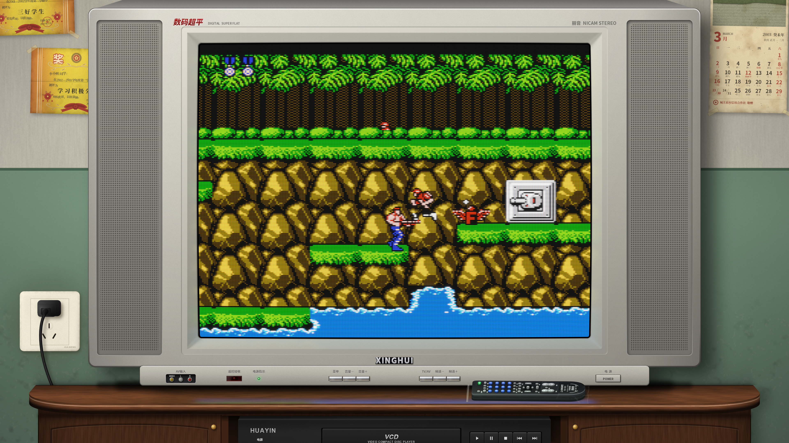
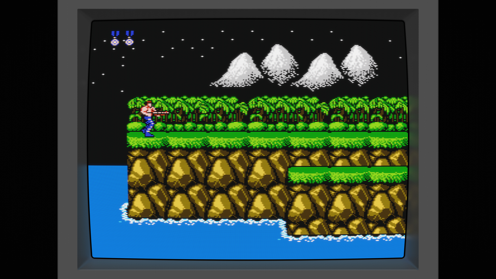
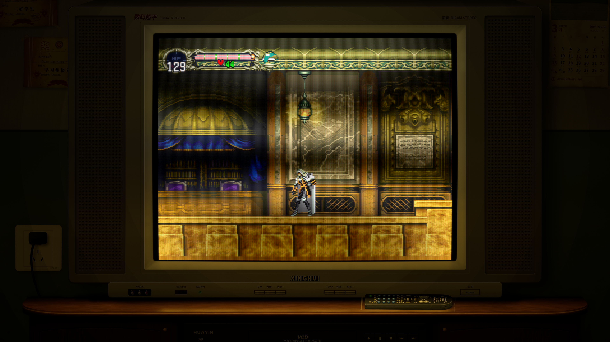
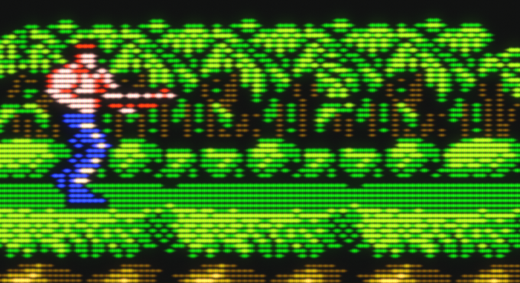
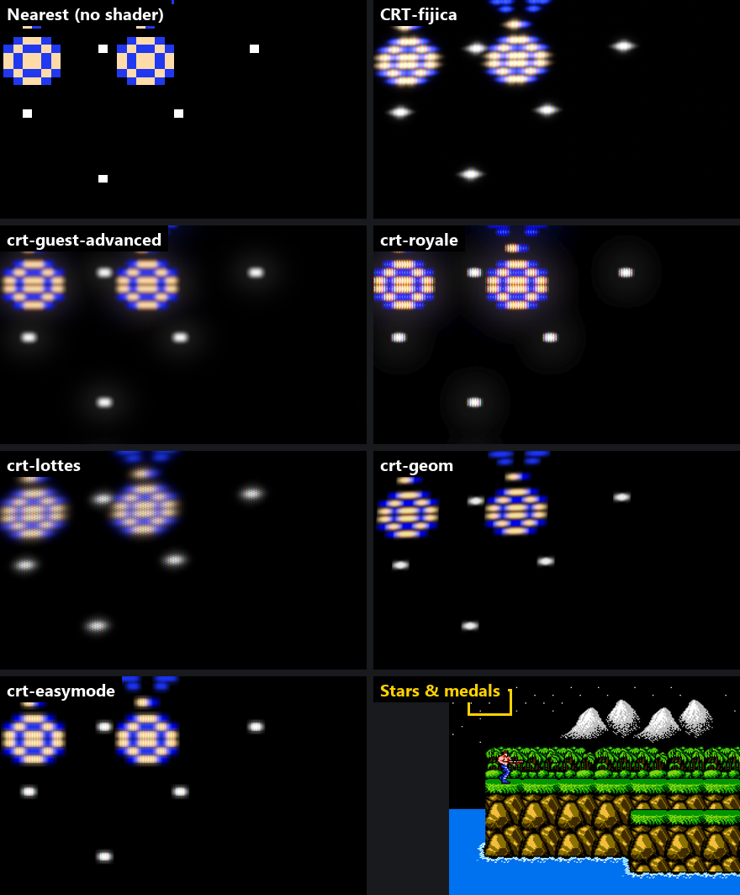
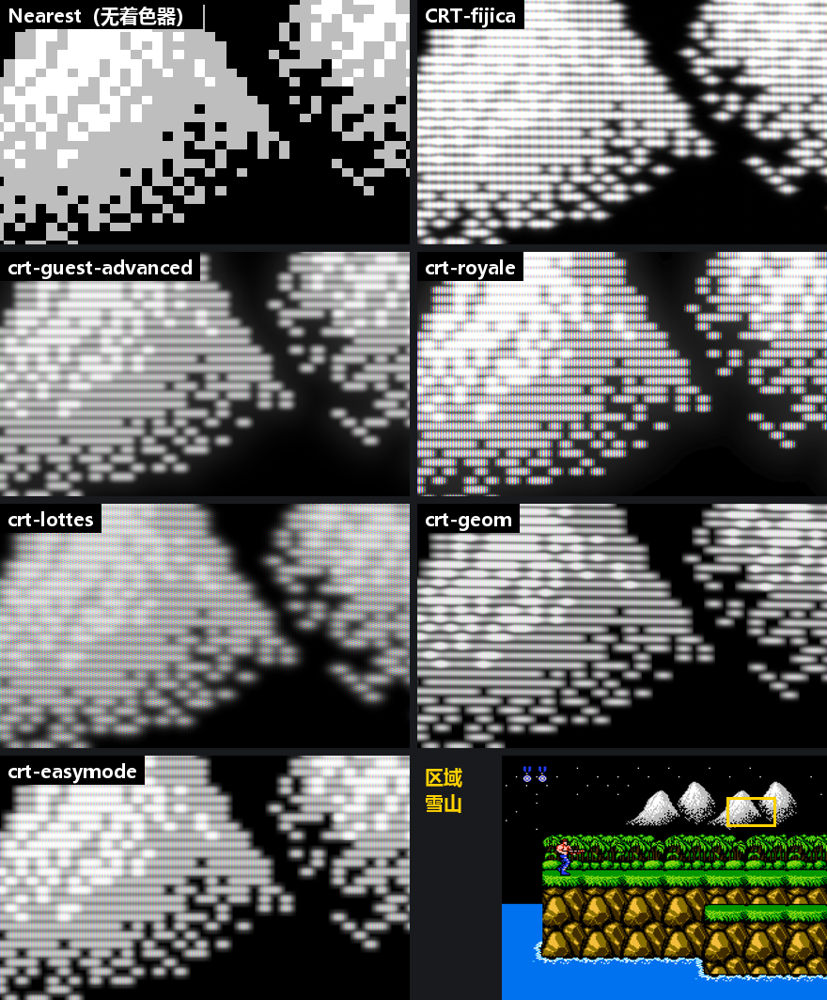
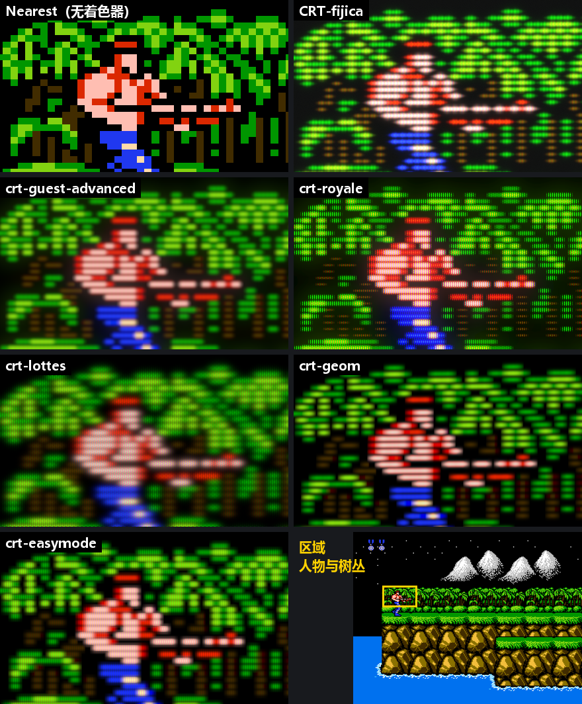
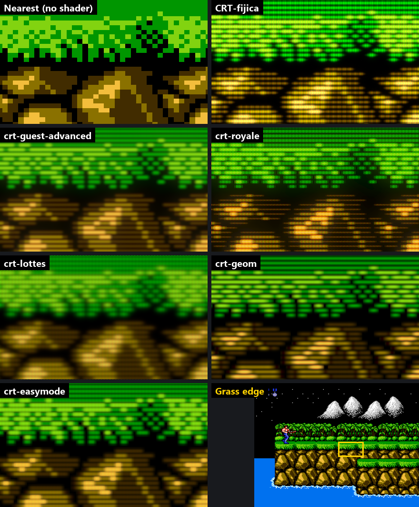
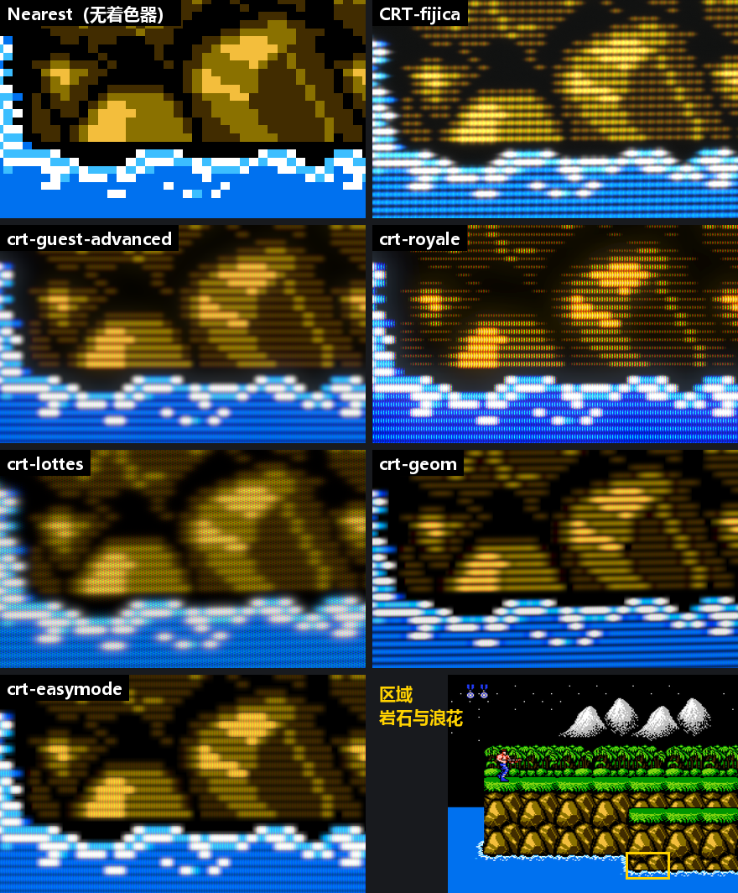
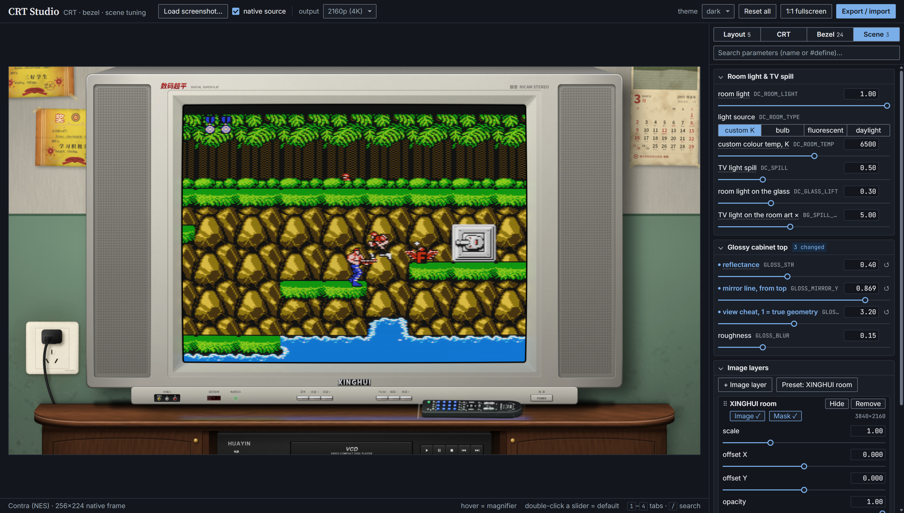

# CRT-fijica

[English](README.md) · **简体中文**

**受物理启发的 RetroArch CRT 着色器，附带可独立替换的边框与场景。**



CRT-fijica（名字取自日语フィジカル，physical）不靠一层层叠特效，而是沿着显像管的物理过程逐级计算：
电子枪 → 电子束 → 荧光粉 → 余辉 → 玻璃散射。
扫描线的粗细、亮部的泛光、边缘的暗角、玻璃的光晕，都是这条链自然得出的结果。

屏幕之外的部分是独立的一层，和 CRT 只通过一份屏幕几何约定对接：
- 斜面边框和平框；
- 屏幕在边框上的倒影；
- 背景场景；
- 房间光照与电视溢光。

两边可以各自替换，曲率和位置始终一致。

## 特点

- **物理 CRT**：
  - 电子束的空间电荷展宽让亮部变粗；
  - 能量守恒的扫描线卷积在纯色区域也保留扫描线；
  - 三种荧光粉掩膜（栅格 / 槽孔 / 点阵）；
  - 分通道余辉（绿、蓝有拖尾，红几乎没有）；
  - 玻璃散射光晕；
  - 支持逐行与隔行扫描。
- **球面荧光屏**：画面按偏转角铺在一块球面玻璃上，横竖两个方向的曲率可以分别设置。
- **几何建模的边框**：内沿、斜面、外沿、平框都是带法线的曲面，统一由一个光源照明（漫反射 + 塑料高光）。亮边和暗边随光源方向变化，不用手工绘制。
- **场景光照**：
  - 房间亮度可以从白天连续调到关灯；
  - 光源可选白炽灯、荧光灯、日光或自定义色温；
  - 电视画面会照亮周围的边框、柜面和墙；
  - 有光泽的柜面会映出画面倒影。
- **CRT Studio**：浏览器里的调参工具，和着色器逐行对应，所见即所得，一键导出参数。

## 截图

| 纯物理预设：程序化边框 | 客厅场景，夜里关灯 |
|---|---|
|  |  |

1:1 局部：扫描线随亮度变粗，荧光粉栅格和泛光清晰可见。



截图均为 3840×2160 原图。扫描线和掩膜是只有几个像素宽的周期纹理，缩小显示时会出现摩尔纹，点开按 100% 查看最准确。

## 与其他着色器对比

同一张 *Contra* 原生帧（256×224）分别经过 RetroArch 自带的几个经典 CRT 着色器和本项目处理。全部在 RetroArch 中实际运行：
- Vulkan 驱动，4:3 全屏输出 2880×2160，GPU 截图；
- 各着色器都用默认预设；
- 本项目用一个只画 CRT 的对比预设：物理链和 `crt-decoupled-physics` 完全相同，但不画边框、平框和倒影，屏幕外和其他着色器一样是纯黑；屏幕占满画面，并关闭房间光（`DC_ROOM_LIGHT` 0）。

下面每张都是 1:1 像素的局部，没有缩放；右下角标出了区域在画面中的位置。

**星空与奖章**：单个像素的星星和细小的高亮精灵，主要看亮点外围的晕染：光晕扩散得多远、衰减得是否自然



本项目的光晕平滑地一直衰减下去：整条管线在浮点帧缓冲里计算，输出前再加一层抖动，暗部不会出现色彩断层。crt-royale 的光晕在 8 位帧缓冲里、以低分辨率计算，暗部只剩几级灰度，星星外面会出现一圈边缘清楚的暗圈。

**雪山**：大片亮部和抖动的白点



**人物与树丛**：细小的绿色细节和肤色



**草地边缘**：亮绿到黑的明暗交界



**岩石与浪花**：暗部层次和白色高光



实际使用时本项目默认开着房间光（`DC_ROOM_LIGHT` 1），玻璃会反射一点室内光，黑色会略微泛灰。

## 性能

同样的输入，在 RetroArch 里关闭垂直同步和音频同步、不限帧率运行，按每帧耗时比较。各着色器之间在同样的 4:3 输出（2880×2160）下比较；本项目的两个完整预设按它们实际使用的 16:9 全屏（3840×2160）测量。用两次不同帧数的总耗时之差计算，扣除了启动和着色器编译时间。测试环境：RTX 4070 SUPER，Vulkan。

| 着色器 | 每帧耗时 | 帧率 |
|---|---|---|
| Nearest（无着色器，即 RetroArch 本身的开销） | 0.26 ms | ~3800 fps |
| crt-easymode | 0.42 ms | ~2400 fps |
| crt-geom | 0.76 ms | ~1300 fps |
| crt-guest-advanced | 0.94 ms | ~1060 fps |
| crt-royale | 0.95 ms | ~1050 fps |
| **CRT-fijica**，只画 CRT（同上面对比所用） | 0.99 ms | ~1010 fps |
| crt-lottes | 1.18 ms | ~850 fps |
| **CRT-fijica** `crt-decoupled-physics`（加边框与倒影），16:9 3840×2160 | 1.72 ms | ~580 fps |
| **CRT-fijica** `crt-decoupled-xinghui`（加客厅场景），16:9 3840×2160 | 1.73 ms | ~580 fps |

只画 CRT 时，开销和 guest-advanced、royale 在同一档。即使是 4K 下完整的客厅场景，在 60 Hz 下也只占每帧 16.7 ms 预算的约 10%。各次测量之间约有 5–8% 的波动。

## 安装

1. 使用支持 slang 着色器的视频驱动：Vulkan（推荐）、D3D11/12 或 glcore。
2. 把本仓库放进 RetroArch 的 `shaders` 目录，或者建一个链接。Windows 上可以这样做：

   ```bat
   mklink /J "<RetroArch>\shaders\CRT-fijica" "<仓库目录>"
   ```

3. 在 RetroArch 菜单中依次进入 **着色器 → 加载预设**，选择一个预设。

## 预设

| 预设 | 内容 |
|---|---|
| `crt-decoupled-physics.slangp` | 物理 CRT + 深灰程序化边框，无背景 |
| `crt-decoupled-xinghui.slangp` | 2000 年代中国客厅：银色电视、电视柜、VCD、遥控器 |

## 调参

### 运行时参数

可以在 RetroArch 的着色器参数菜单里直接调。

**CRT**

| 参数 | 作用 |
|---|---|
| `gamma_gun` | 电子枪伽马（整体对比度） |
| `sigma0` / `sigma_h` | 电子束垂直 / 水平宽度（扫描线粗细 / 水平柔和度） |
| `k_sc` / `alpha_sc` | 亮部变粗的程度 / 曲线形状 |
| `scan_gamma` | 扫描线对比度：加深暗处扫描线之间的缝。这是审美参数，不属于物理链；亮行被空间电荷填满的缝不受影响 |
| `mask_type` / `mask_pitch` / `mask_strength` | 掩膜类型 / 间距（输出像素）/ 强度 |
| `e_sat` / `brightness` | 荧光粉饱和拐点 / 亮度 |
| `persist_r/g/b` | 各通道余辉：每帧的光在 60 Hz 下一帧还剩的比例（按实际刷新率换算），拖尾叠加在新画面上 |
| `halo_weight` / `halo_spread` | 玻璃光晕强度 / 半径 |
| `vignette` / `d_gun` / `k_edge` | 边缘暗角 / 偏转距离 / 边缘光斑拉长 |
| `scan_mode` / `interlace_off` | 逐行、隔行或自动 / 隔行时另一场的亮度（感知参数，控制闪烁程度） |

**布局（`Layout:`）**

| 参数 | 作用 |
|---|---|
| `DC_SCALE` / `DC_POS_X` / `DC_POS_Y` | 屏幕大小 / 中心位置 |
| `DC_ASPECT` | 画面宽高比 |
| `DC_CURVE_X` / `DC_CURVE_Y` | 荧光屏沿宽度 / 沿高度的弯曲（分别让上下边、左右边变弯） |
| `DC_CORNER` | 屏幕圆角 |
| `DC_BG_ON` / `DC_FG_ON` | 背景 / 前景图开关 |

**光照（`Light:`）**

| 参数 | 作用 |
|---|---|
| `DC_ROOM_LIGHT` | 房间亮度：0 关灯，0.5 台灯，1 白天 |
| `DC_ROOM_TYPE` / `DC_ROOM_TEMP` | 光源类型（自定义色温、白炽灯、荧光灯、日光）/ 自定义色温 |
| `DC_SPILL` | 电视画面照亮周围的强度 |
| `DC_GLASS_LIFT` | 房间光在屏幕玻璃上的泛白 |

### 边框外观

边框的形状、材质和光照是编译期参数，默认值都在 `decoupled/dc-composite.inc` 里。
做一种新外观，只需写一个包装文件，覆盖想改的参数，再 include 它：

```glsl
#version 450
#define BZL_COLOR_VAL   0.73     // 银色塑料
#define LIGHT_ANGLE     135.0    // 光从左上来
#define GLOSS_STR       0.40     // 柜面倒影
#include "dc-composite.inc"
```

| 分组 | 参数 |
|---|---|
| 尺寸 | `BZL_WIDTH(_X)`、`FRM_WIDTH(_X)`、`BZL_OUTER_CORNER`、`FRM_OUTER_CORNER` |
| 材质 | `BZL_COLOR_HUE/SAT/VAL`、`BZL_NOISE`、`BZL_GLOSS`、`BZL_SHINE`、`FRM_COLOR_*` |
| 光照 | `LIGHT_ANGLE`、`LIGHT_ELEV`、`AMBIENT`、`BZL_SLOPE`、`LIGHT_GRAD_X/Y` |
| 圆角 | `LIP_WIDTH`、`LIP_ROLL`、`BZL_EDGE_W`、`FRM_EDGE_W`、`FRM_EDGE_ROLL` |
| 斜接缝 | `CORNER_FADE`、`CREASE_W_IN/OUT`、`CREASE_STR` |
| 屏幕倒影 | `REFL_STR`、`REFL_FALLOFF`、`REFL_BLUR`、`REFL_CORNER` |
| 柜面倒影 | `GLOSS_STR`、`GLOSS_MIRROR_Y`、`GLOSS_STRETCH`、`GLOSS_BLUR` |

长度以显像管高度为单位，角度以度为单位。每个参数的含义写在 `dc-composite.inc` 的注释里。最方便的做法是在 CRT Studio 里调好再导出。

## 工作原理

```
游戏画面
 │ 01 linearize      信号解码，电子枪响应 → 线性束流
 │ 02 beam-v         垂直方向的电子束卷积（能量守恒），逐行 / 隔行扫描
 │ 03 beam-h         水平方向的电子束卷积
 │ 04 phosphor       荧光粉掩膜、饱和与余辉
 │ 05–07 halo        玻璃散射光晕（1/4 分辨率，可分离高斯）
 ▼
 │ dc-crt-physics    把画面按屏幕几何弯曲、定位
 │ dc-composite      边框、屏幕倒影、背景、场景光照
 │ dc-foreground     （可选）盖在玻璃前面的图层
 ▼
输出
```

**屏幕几何约定。** CRT、边框和倒影只共享一组参数：屏幕的位置、大小、宽高比、曲率和圆角，定义在 `decoupled/dc-screen-layout.inc` 里。三者读同一组参数，所以总是对齐的，替换其中任何一部分都不影响其他部分。

**荧光屏曲面。** 荧光屏被看作一块球面玻璃，电子束按偏转角均匀扫过。从正前方看，画面中心略微放大，边缘中点固定，四角向内收。这个映射正反两个方向都有解析解。

**边框。** 从显像管往外看，边框是一条截面轮廓：
1. 黑边；
2. 卷向管内的内沿；
3. 四个斜面（以直线斜接）；
4. 圆角过渡的外沿；
5. 平框；
6. 平框外沿。

每一段的法线都由几何决定，用同一个光源计算漫反射和高光。斜接缝按两个相邻斜面中间方向的法线受光。

**场景光照。** 所有画出来的东西都在线性空间里乘以房间光，再加上电视溢光：
- 边框、平框、背景图都受光；
- 溢光的颜色取自画面的模糊 mip，所以预设开启了 `mipmap_input`；
- 背景图的 `SpillMask` 贴图标出每个像素接收多少溢光（R 通道）和哪里是会映出画面的光面（G 通道）。

## 工具

**CRT Studio**（`tools/crt-studio.html`）：直接用浏览器打开即可。



- **管线复刻**：用 WebGL 完整复刻上面的管线，载入一张游戏截图（拖进窗口即可）就能实时调所有参数。
- **导出 / 导入**：
  - 导出一次给出全部 `#define` 和 `DC_*` 值；
  - 也可以把已有的包装文件或预设粘贴回来。
- **图层栈**：可以叠加背景、前景图片和溢光遮罩，预览完整场景。
- **看像素**：悬停放大镜和 1:1 全屏用来检查真实像素；预览窗口经过低通处理，不会出现摩尔纹。

**其他工具**

| 文件 | 用途 |
|---|---|
| `tools/slang-check.py` | 按 RetroArch 的方式编译检查 `.slang` / `.slangp`，需要 [glslang](https://github.com/KhronosGroup/glslang/releases)（`--glslang`、`GLSLANG` 环境变量或 PATH） |
| `tools/ra-native.py` | 从放大后的 RetroArch 截图还原原生分辨率的帧，作为 CRT Studio 的输入 |

## 场景美术

客厅场景由 `art/` 下的 Python 脚本程序化绘制。依赖：
- `skia-python`、`numpy`、`scipy`、`Pillow`；
- Noto Sans / Serif CJK SC 字体。

```sh
cd art
python make_tv.py       # 电视外壳（屏幕和边框留给着色器）
python make_bg.py       # 墙面、插座、电视柜、VCD
python make_props.py    # 柜面上的遥控器
python compose.py       # 合成预览 → art/out/
python export_ra.py     # 生成 RetroArch 贴图（背景 + 溢光遮罩）
python dc_params.py     # 生成 dc-composite-xinghui.slang 和预设的布局参数
```

- **共享几何**：屏幕几何只在 `common.py` 中定义一份，美术和着色器参数都从它派生。
- **真实尺寸**：所有道具都按真实尺寸和柜面透视摆放（电视面上为 34 px/cm）。
- **虚构品牌**：场景里的品牌和人名均为虚构。

## 目录结构

```
crt-decoupled-*.slangp   预设
crt-physics/             物理 CRT（pass 01–07）
decoupled/               屏幕几何、边框与场景合成、贴图
tools/                   CRT Studio 与命令行工具
art/                     场景美术脚本
docs/                    截图与对比图
```

## 致谢

- [libretro](https://www.libretro.com/) 的 RetroArch 和 slang 着色器格式
- Duimon 的设备美术，场景构图方式受其启发

## 许可证

- **代码**（着色器、预设、工具、`art/` 下的脚本）：[MIT](LICENSE)
- **美术**（客厅场景贴图、脚本生成的图像、截图中的房间与边框）：[CC BY 4.0](LICENSE-ART.md)，使用时注明出处即可

截图中的游戏画面（*Contra*、*恶魔城 月下夜想曲*）版权归各自权利人所有，不在上述许可范围内。
